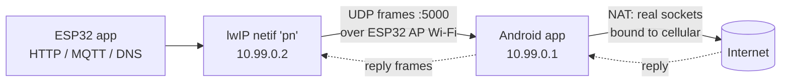

# reverse-net

**Give an ESP32 internet through your own Android phone — no router, no hotspot.**

The ESP32 runs a Wi-Fi access point and a virtual network card (`phonenet`). Your phone joins that Wi-Fi, runs the reverse-net Android app, and relays the ESP32's IP traffic out over mobile data.

> **Status: v0.2.0, experimental.** DNS, ping, plain HTTP and HTTPS are implemented end to end. The Android app builds and its 28 unit tests pass; the ESP32 firmware has **not** been compiled or run on hardware yet. See [Project status](#project-status).



## Why this exists

Many ESP32 projects need the internet (MQTT, HTTPS APIs, time sync, OTA updates) but are deployed where there is no Wi-Fi router: in a field, a vehicle, a workshop, or a demo bench. A phone already has a mobile data connection, so this project uses it as the uplink. The ESP32 needs no SIM, no router and no extra hardware, and the only setup is joining the ESP32 network from your phone.

It is also a learning project. It shows how a user-space network stack works end to end: how lwIP builds packets, how a custom network interface relays them, and how a NAT rebuilds connections on a device that cannot run kernel NAT.

## How it works

1. Your ESP32 code opens a normal socket; lwIP builds an IP packet.
2. The `pn` network interface wraps the packet in a 3-byte-header frame and sends it by UDP to the phone.
3. The Android app unwraps it, opens a real socket on the **cellular** network and forwards the data.
4. The reply returns the same way, so the ESP32 behaves as if it had real internet.

Android apps cannot do kernel NAT, so the app rebuilds each UDP/TCP connection itself ([how TCP works](docs/tcp.md)) — that is the hard part of this project.

**This is a private link, not a hotspot.** Only the reverse-net app can use it. Other devices joining the ESP32 Wi-Fi get no internet.

## Repository layout

| Path | What it is |
| --- | --- |
| [`esp32/components/phonenet`](esp32/components/phonenet) | ESP-IDF component: virtual netif + frame transport (C) |
| [`esp32/examples/basic`](esp32/examples/basic) | Minimal example: SoftAP + phonenet + HTTP GET |
| [`android/`](android) | Android relay app (Kotlin): link loop, IPv4 parser, ICMP, UDP/DNS NAT, TCP NAT |
| [`tools/`](tools) | `pc_relay.py` (test the ESP32 without a phone), `frame_dump.py` (Wireshark helper) |
| [`build-from-scratch/`](build-from-scratch) | Step-by-step guide to build the whole project yourself, ESP32 and Android tracks |
| [`docs/`](docs) | [Protocol](docs/protocol.md), [TCP design](docs/tcp.md), [architecture](docs/architecture.md), [troubleshooting](docs/troubleshooting.md), [roadmap](docs/roadmap.md), [original guide](docs/guide.md) |

## Quick start

### 1. ESP32

Requires [ESP-IDF](https://docs.espressif.com/projects/esp-idf/) 5.x.

```sh
cd esp32/examples/basic
idf.py set-target esp32
idf.py menuconfig        # Reverse-Net Example: set AP SSID / password
idf.py build flash monitor
```

Use your own component in a project by copying `esp32/components/phonenet` into your project's `components/` directory, then:

```c
wifi_init_softap();      /* your existing AP setup */
phonenet_start();
while (!phonenet_is_up()) vTaskDelay(pdMS_TO_TICKS(500));
/* esp_http_client, esp-tls, MQTT now work as normal */
```

### 2. Android

Open `android/` in Android Studio (or run `cd android && ./gradlew assembleDebug`, APK in `app/build/outputs/apk/debug/`), install the app, join the ESP32 Wi-Fi, accept "stay connected" when Android warns the network has no internet, and tap **Start relay**.

### 3. No phone yet? Use the PC relay

```sh
python3 tools/pc_relay.py --esp 192.168.4.1
```

Join the ESP32 AP from your computer; the script speaks the same protocol and answers pings to `10.99.0.1`.

## Project status

Legend: ✅ verified by automated tests · 🟡 implemented, not yet verified on hardware · ⬜ needs hardware

| # | Milestone | Status |
| --- | --- | --- |
| 1 | ESP32 AP reachable from the phone | ⬜ needs hardware |
| 2 | HELLO / `link up` handshake | ✅ Android side and PC relay (loopback tests) · 🟡 ESP32 side |
| 3 | App holds Wi-Fi + cellular networks | 🟡 implemented, needs a phone |
| 4 | ESP32 pings `10.99.0.1` | ✅ ICMP logic tested · 🟡 end to end |
| 5 | DNS via UDP NAT | ✅ UDP NAT tested on loopback · 🟡 end to end |
| 6 | Plain HTTP (TCP NAT) | ✅ TCP NAT tested on loopback (11 tests) · 🟡 end to end |
| 7 | HTTPS | 🟡 same path as HTTP plus TLS on the ESP32; needs ~40 KB heap |
| 8 | Auto-reconnect | 🟡 implemented, needs hardware |

Test reports from real devices are welcome; please open an issue with your ESP32 variant, phone model and Android version.

## Limits and risks

- **Not universal** — one Android peer only.
- **No encryption or authentication in protocol v1.** Use a strong AP password. See [SECURITY.md](SECURITY.md).
- **Speed:** a few Mbit/s at best on the ESP32.
- **Android may fight you:** it can drop a Wi-Fi network without internet. The explicit `requestNetwork` calls are meant to avoid that; test on your phone model.
- **IPv4 only**; ICMP only for pings to `10.99.0.1`; TCP has no congestion control or out-of-order reassembly (see [docs/tcp.md](docs/tcp.md)).

## Contributing

Issues and pull requests are welcome — see [CONTRIBUTING.md](CONTRIBUTING.md). Hardware test reports (ESP32 variant, phone model, Android version) are especially valuable.

## License

[MIT](LICENSE)
