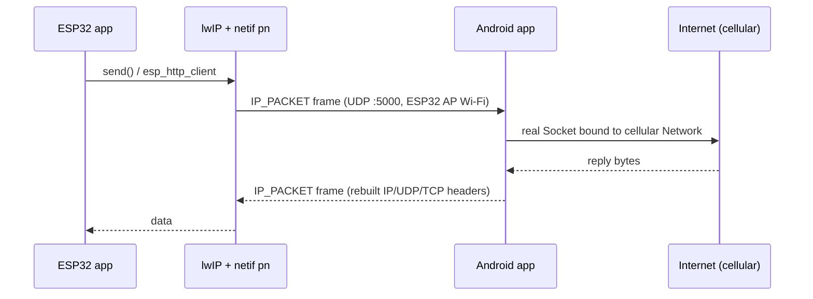

# Architecture

## Data path

## Components

**ESP32 (`esp32/components/phonenet`)**
- Adds lwIP netif `pn` (`10.99.0.2/24`, gateway `10.99.0.1`).
- `pn_output` copies each outgoing pbuf into a frame and `sendto`s the peer.
- One FreeRTOS task receives frames, runs the handshake/keepalive, and injects IP_PACKET payloads into lwIP.
- When the link is up `pn` becomes the default netif and DNS is set to `8.8.8.8`.

**Android (`android/`)**
- `RelayService` – foreground service owning everything below.
- `NetworkManager` – `requestNetwork` for cellular (internet) and Wi-Fi (no internet) and exposes both `Network`s.
- `LinkLoop` – protocol v1 handshake/keepalive on a socket bound to the Wi-Fi network.
- `PacketDispatcher` – parses IPv4 and routes to `IcmpHandler`, `UdpNat` or `TcpNat`.
- `UdpNat` – flow table keyed by (src port, dst IP, dst port); each flow owns a cellular `DatagramSocket`.
- `TcpNat` – same key, but each flow is a small TCP state machine with a cellular `Socket` plus reader and writer threads. See [tcp.md](tcp.md).

## Why packets do not loop

lwIP routes by longest prefix. Frames to `192.168.4.x` match the AP interface exactly and stay there. Everything else goes to the default netif, which is `pn` once the link is up. The tunnel transport therefore never re-enters the tunnel.
